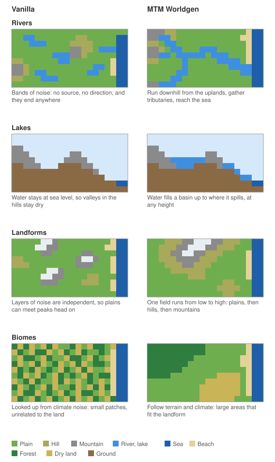

# MTM Worldgen

A Minecraft mod that replaces overworld generation with continuous, believable landforms: continents, plains, hills and mountains, river networks that run from the uplands to the sea, and climate zones. It is designed at real scale, with one block as one metre, so that long transit lines have room to run, while keeping mountains exaggerated enough to be worth looking at.

The mod adds a new world type. Existing vanilla worlds, the Nether and the End are not affected.

> **Early development.** Terrain changes between versions, and worlds made with one version may not load in the next. Do not use it for worlds you want to keep yet.

## Requirements

| | |
|---|---|
| Minecraft | 1.18.2 |
| Java | 17 |
| Fabric | Loader 0.14.25, Fabric API 0.77.0 |
| Forge | 40.2.10 |

Later Minecraft versions and NeoForge are planned. No other mods are required.

## Using the mod

1. Install the jar for your loader.
2. In the Create World screen, choose the MTM world type under **More World Options**.

Build height runs from -64 to 800 by default, following the configured maximum surface height.

## Terrain

- **Continents and oceans.** Land is grouped into continents separated by straits and open oceans, about 30% ocean by default.
- **Three tiers of land.** One continuous field divides land into plains, hills and mountains, so hills always lie between plains and mountains and can also stand alone. Plains are left wide enough for big cities.
- **Mountains.** Ranges follow winding ridges, and blend along their length between a steep igneous form and a gentle wind-worn one. Isolated peaks stand where hills meet mountains, and rounded dome hills stand among the hills. Along coasts, mountains give way to hills.
- **Water.** Rivers start only in hills and mountains, grow from streams through tributaries to major trunks, and widen on gentle ground. They run through valleys and floodplains, feed lakes that fill real depressions, and settle to sea level before reaching the coast.
- **Climate.** Tropical, temperate, cold and polar zones, with snow lines by zone and biomes assigned from terrain, climate and humidity.
- **Coasts and islands.** Sand, gravel, rock and sea cliff coasts follow each other along the shore, and sand, rock and mushroom islands dot the open sea.
- **Surface.** Bare rock on steep ground and snow above the snow line. Caves and ravines stay below the surface.

Generation only depends on the seed, the coordinates and the settings of the world. The same seed and settings give the same terrain on Fabric and Forge, and in any exploration order.

Not done yet: deltas, harbors, sinkholes and karst, vegetation zones, cliffs and rock strata, saving terrain logic to disk, and blending into existing worlds.

## How it works

The mod keeps vanilla's chunk generator and replaces what it reads. Custom density functions tell it where the ground is, a custom biome source assigns biomes, and a few mixins add what density cannot express, such as water above sea level. Vanilla's surface rules, carvers, features and structures then run as usual.

### Why vanilla's terrain rules are not enough

The chunk generator itself is kept, but the terrain it normally computes cannot express this logic, even with data packs that retune it. Vanilla decides each block from noise at that point alone, through climate parameters and density functions. Nothing in that model can see beyond the position being computed:

- **Rivers need to know what lies upstream and downstream.** A river has to run downhill all the way, gather water from a whole basin and end in a sea or lake. Vanilla's rivers are bands of noise where a field crosses a value: they have no direction, no source, no size that grows, and they cannot link one place to another.
- **Water finds its own level.** A lake's surface depends on where its basin spills, which can be many kilometres away. Vanilla only knows sea level and local aquifers, so its water cannot sit at a height set by distant terrain, or descend along a course.
- **Landforms need order.** Plains should meet mountains through hills, and valleys should cut through where rivers actually run. Independent noise layers only produce that by chance, and shaping one layer to follow another turns into tuning fields against each other.
- **Biomes follow from terrain, not the reverse.** Vanilla looks biomes up from the same climate values that shape the land, so a biome cannot depend on real height, slope or distance to a snow line, and small climate changes produce mosaics.
- **Height costs time.** Vanilla evaluates 3D noise through the whole column. Doing that for a world over twice as tall would be far slower, while a height map only needs the surface.

The sketch below shows the difference, in simplified maps and a cross section. They are illustrations, not actual output.



So terrain is computed first, as large-scale logic that can look across thousands of blocks, and vanilla's generator is handed the result as its density. The rest of its pipeline, from surface rules to structures, keeps working unchanged. This logic stays deterministic because it never depends on generated chunks, only on the seed and coordinates.

### Terrain as a function of position

Everything is computed from the seed and block coordinates, without depending on what was generated before. That is what makes terrain independent of exploration order and thread timing, and identical across loaders. It also means neighboring areas always agree, so large-scale features need no stitching at borders. Logic regions of 4096 by 4096 blocks are only a cache of these results, not boundaries.

Height is built up in layers, each only depending on the ones before it:

1. **Continents.** Jittered Voronoi plates are grouped into landmasses, and a value that rises away from plate borders gives the coastlines, warped by noise. The land threshold is a per-seed quantile, so the ocean share holds for every seed.
2. **Climate.** A continuous temperature field is cut into zones in order, so tropical and cold zones can never touch. A separate field gives humidity.
3. **Tiers.** One low-frequency field divides land into plains, hills and mountains by quantile. It is capped near coasts, which turns mountains into hills there.
4. **Mountains.** Sites on a jittered grid link along a low-frequency direction field into winding ridge chains. A cross-section profile around each ridge gives the mountain body, with its shape and width derived from the slope limit, and a smooth maximum merges overlapping ridges. A ridged texture sampled in the frame of the ridge adds spurs and gullies that run down the flanks.
5. **Drainage.** See below.
6. **Surface and biomes.** Snow lines, bare rock, beaches and biomes follow from height, slope, climate and humidity.

### Rivers and lakes

Rivers are routed on a sparse grid with 256 block cells, in a window reaching 32768 blocks around each region:

- **Routing.** A priority flood runs inland from the sea, always continuing from the lowest water level reached so far. Each cell drains to the cell that reached it, so depressions fill up to their spill point and every cell finds a way out. Filled cells become lakes.
- **Size.** Catchment is counted along the routes, and tributaries are counted along each trunk to find major trunks. Water that never touched hills or mountains forms no river.
- **Courses.** Each cell gets a jittered node, and each flow edge a smooth curve with meanders seeded by that edge alone, so any region that builds an edge gets the same curve. Big rivers average their nodes over a longer stretch, because they are wider than the node spacing.
- **Shaping the land.** Ridge texture fades out near rivers, leaving them the same smooth ground they were routed on. Valley walls then bound the land from above and below, and low land nearby is flattened into a floodplain just above the water.
- **Water.** Water surfaces come from the routing grid and are written into chunks before surface rules run. Banks are built up or dug out around them where interpolated blocks land off the computed height. Lakes fill the real terrain, so their shores follow it.

### Performance

Terrain is a height map rather than vanilla's 3D noise, so density is simple to compute. Chunks are only filled up to their highest surface, which skips interpolation, aquifers and ore veins for the air above it, and this is where most of the time is saved. Logic that many columns share is cached by region. Expensive steps run on a small fork-join pool, which is safe because they are pure functions of the seed and coordinates, so the number of threads cannot change the result.

## Configuration

Settings live in `config/mtm_worldgen.json`, created with default values on first use. Missing fields use their defaults, and invalid values are reported when a world is created.

The file only applies to new worlds. Each world stores its settings when created, so later edits cannot cause seams in it.

| Group | Controls |
|---|---|
| `general` | Maximum surface height, sea level, logic region and grid sizes, cave and village limits |
| `slopes` | Grade limits by landform |
| `continents` | Ocean share, continent size and coastline shape |
| `plains`, `hills`, `mountains`, `plateaus` | Tier shares, heights, ridge shape and mountain styles |
| `isolated` | Isolated peaks and dome hills |
| `rivers` | Routing, river classes, widths, valleys, floodplains and lakes |
| `surface`, `beaches`, `islands` | Snow lines, bare rock, coast types and islands |
| `climate`, `biomes` | Climate zone shares and sizes, and the biomes of each zone |
| `spawn` | World spawn search |

## Commands

All commands need cheats enabled.

| Command | Effect |
|---|---|
| `/mtm flyspeed <factor>` | Sets flying speed, 0.1 to 50 times the default. `reset` restores it, and no argument shows it |
| `/mtm locate mountain` | Finds the nearest high mountain, with a coordinate you can click to teleport |
| `/mtm debugmap [blocksPerPixel]` | Saves a map of the terrain and rivers around you to `<world>/mtm_worldgen/debug/` |
| `/mtm benchmark` | Compares chunk generation time with vanilla (biome and noise stages only) |

## Development

Building needs a JDK 17 toolchain. Gradle itself can run on JDK 21, and toolchains are not downloaded automatically. If Gradle cannot find JDK 17, set `org.gradle.java.installations.paths` in `~/.gradle/gradle.properties`.

```
gradlew build                     Build all modules; jars are in fabric/build/libs and forge/build/libs
gradlew :fabric:runClient         Run a development client
gradlew :forge:runClient
gradlew :common:test              Unit tests of the terrain logic
gradlew :fabric:runGametest       In-game tests
gradlew :forge:runGameTestServer
```

All terrain logic lives in the `common` module, and the loader modules only register it and hook it up:

| Package | Contents |
|---|---|
| `logic` | Terrain logic in plain Java, with no Minecraft classes |
| `noise` | Stateless, deterministic noise |
| `world` | Connection to the vanilla generator |
| `command` | Debug commands |
| `gametest` | In-game tests, run on both loaders |

Both loaders are tested against the same terrain hash. After an intentional terrain change, update `EXPECTED_COLUMN_HASH` in `MtmGameTests`; the failure message prints the new value.

## License

[MIT](LICENSE)
