# Architecture

How Realistic Landforms is laid out and how it runs: the modules and packages, what each part is for, and how a world and its chunks are generated. The diagrams are UML in Mermaid, which GitHub renders in place. For the design ideas behind the terrain, see [How it works](how-it-works.md); for building and tests, see [Building and development](development.md).

## Code structure

```
core/                       Terrain logic in plain Java, shared by every version (no Minecraft classes)
  logic/                    The pipeline: layers, regions, caches, settings
    debug/                  Height map renderer for debug maps
  noise/                    Stateless deterministic noise: hashing, value noise, fBm, ridged noise
  preview/                  Standalone map viewer (java -jar <mod jar>)
  src/test/                 Unit tests of the logic
versions/<minecraft>/       One set of modules per Minecraft version (1.20.1, 26.3; 26.4 prepared)
  common/                   Connects the logic to that version's vanilla generator
    world/                  Density functions, biome source, water, surface, caves, ores, config
    mixin/                  Hooks into vanilla's generator, world creation, saving and weather
    command/                /mwg debug commands
    gametest/               In-game tests, run on every loader
    benchmark/              Chunk generation benchmark against vanilla
    platform/               Interface for the few things that differ between loaders
  fabric/ forge/ neoforge/  Registration and the platform implementation of one loader each
amidst/                     Amidst map viewer for MTM worlds (GPLv3, separate project)
docs/                       How it works, development, this document
```

The rule that shapes everything: **all terrain is decided in `core`**, as pure functions of the seed, the coordinates and the settings. Version modules only hand those results to vanilla, and loader modules only register things. This keeps terrain identical on every loader and Minecraft version, and in any exploration order.

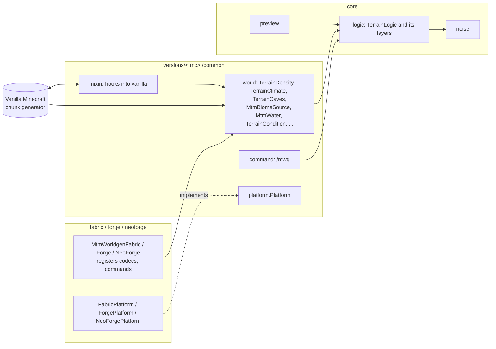

## The terrain logic (`core/logic`)

`TerrainLogic` is the one entry point. A world gets one instance per seed and settings (`TerrainLogic.forWorld`), and every question about the world goes to it: surface height at a column, water level, biome, whether a block is solid, where the spawn is.

It is built from layers that follow the generation pipeline. Each layer is a pure function of the seed and coordinates, or of the layers before it.

| Class | Pipeline step | What it does |
|---|---|---|
| `ContinentLayer` | 1 | Jittered Voronoi plates grouped into continents, coastlines, islands. Plate drift and character, and mountain belts along plate borders (`belt`) |
| `ClimateLayer` | 2 | Temperature zones and humidity |
| `SkeletonLayer` | 3 | Tier field (plains, hills, mountains), mountain ranges, plateaus, hills, isolated peaks, cliff bands |
| `ErosionLayer` | 3 | Stream power erosion simulation per region; branching gullies and creeks |
| `FlowLayer` → `FlowRegion` | 4 | Priority flood routing on a 256 block grid, catchments, river classes, lakes and sinks |
| `LakeLayer` | 5 | Lake shapes and levels on the real ground |
| `RiverLayer` → `RiverRegion` | 4 | River courses as curves, widths, levels, waterfalls, fans, oxbows, deltas, sediment bars |
| `CoastLayer`, `SeaStackLayer` | 7 | Coast types, sea cliffs, sea stacks |
| `BiomeLayer` | 8 | Biome lists and patches by zone and humidity; cave biomes and the deep dark |
| `SinkholeLayer`, `OverhangLayer`, `DesertLayer` | 3, 9 | Sinkholes and their chambers, overhangs on cliffs, dunes and oases |
| `OreHeights` | 10 | Ore height ranges stretched to the taller world |
| `ForeignMap` | | Snapshot of region files merged in from other worlds, and blending toward them |

Support classes:

| Class | What it does |
|---|---|
| `WorldgenSettings` | Every setting, grouped as in the config file; JSON in and out, validation, `resolved()` for `logicRange` |
| `LogicRegion` | Coarse fields of one region (continent height, coast distance) on the 64 block grid |
| `RegionCache` | LRU cache of computed regions: computes each region once, lets threads read without locks, and can hold regions in use |
| `LogicThreads` | Small fork-join pool for the expensive steps, safe because they are pure functions |
| `ErosionStore` | Disk cache of erosion results under `<world>/mtm_worldgen/erosion/` |
| `NoiseStats` | Quantiles of a noise field, which turn shares (30% ocean, 33% plains) into thresholds |

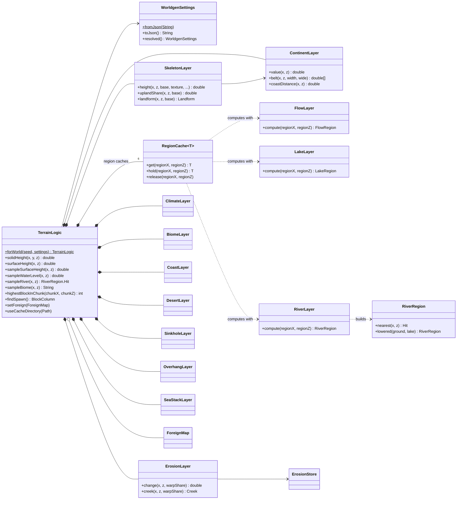

### Regions and how they depend on each other

Large-scale logic is computed per logic region (4096 × 4096 blocks by default) and kept in a `RegionCache`. A region is only a cache unit, not a boundary: every rule depends on the seed, the coordinates and a bounded neighborhood, so neighboring regions agree. A region of one kind may need regions of another kind around it, always in this order:

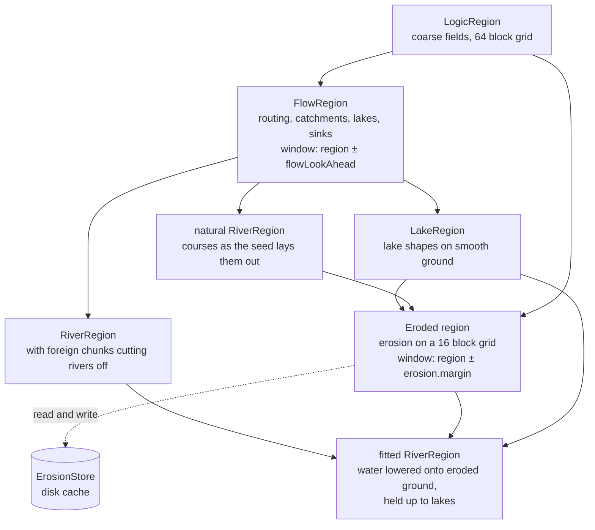

Erosion is the costliest step (about half a second to a second and a half per region). Its results go to disk, so a restart only recomputes the cheap steps. While generating, the neighbors of an eroded region are queued on a background thread, so they are usually ready by the time the player gets there.

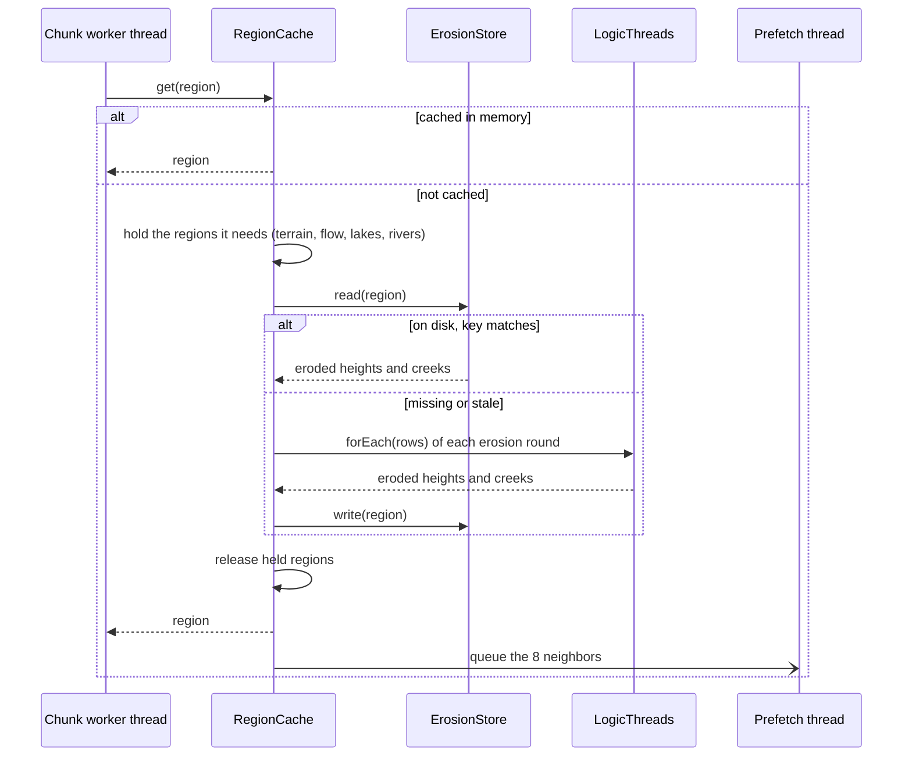

### How one column gets its height

Every column's surface is assembled in stages, from the largest scale to the smallest. Each stage only adds to or shapes the result of the ones before it:

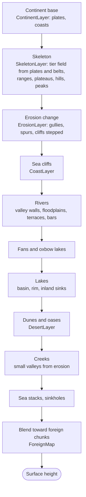

In code this is `sampleSurfaceHeight`, which calls `sampleShapedLand` (creeks), `sampleCarvedLand` (skeleton, erosion and `carve`), and wraps them with sea stacks, sinkholes and foreign blending. Blocks above the height map, such as overhangs and sinkhole chambers, come from `solidHeight`, which density asks for. Results are memoized per column and thread (`ColumnCache`), because one column is asked many times.

## Connecting to Minecraft (`versions/<mc>/common`)

The mod keeps vanilla's chunk generator and replaces what it reads:

| Class | Role |
|---|---|
| `MtmGenerators` | Builds the MTM generator: vanilla `NoiseBasedChunkGenerator` with MTM density functions in its noise router, and the matching dimension type |
| `TerrainDensity` | Density function: positive below `solidHeight`, negative above |
| `TerrainClimate` | Climate density functions derived from the terrain; carries the `TerrainLogic` to the biome source |
| `TerrainCaves` | Vanilla cave density, kept away from the surface |
| `MtmBiomeSource` | Biomes from `TerrainLogic.biomeAt` instead of vanilla's climate lookup |
| `MtmWater` | Fills rivers and lakes before the surface rules run |
| `TerrainCondition` | Surface rule condition for beaches, snow, bare rock and strata |
| `MtmCarving` | Keeps caves and ravines below the surface |
| `MtmOres`, `MtmSnow`, `MtmOasis` | Ores spread over the taller world, the MTM snow line, sugar cane at oases |
| `ForeignChunks` | Finds and fits region files merged in from other worlds when a world loads |
| `MtmConfig` | Reads and writes `config/mtm_worldgen.json` with comments |
| `SeedCapture` | Carries the seed into density functions while vanilla builds the noise router |

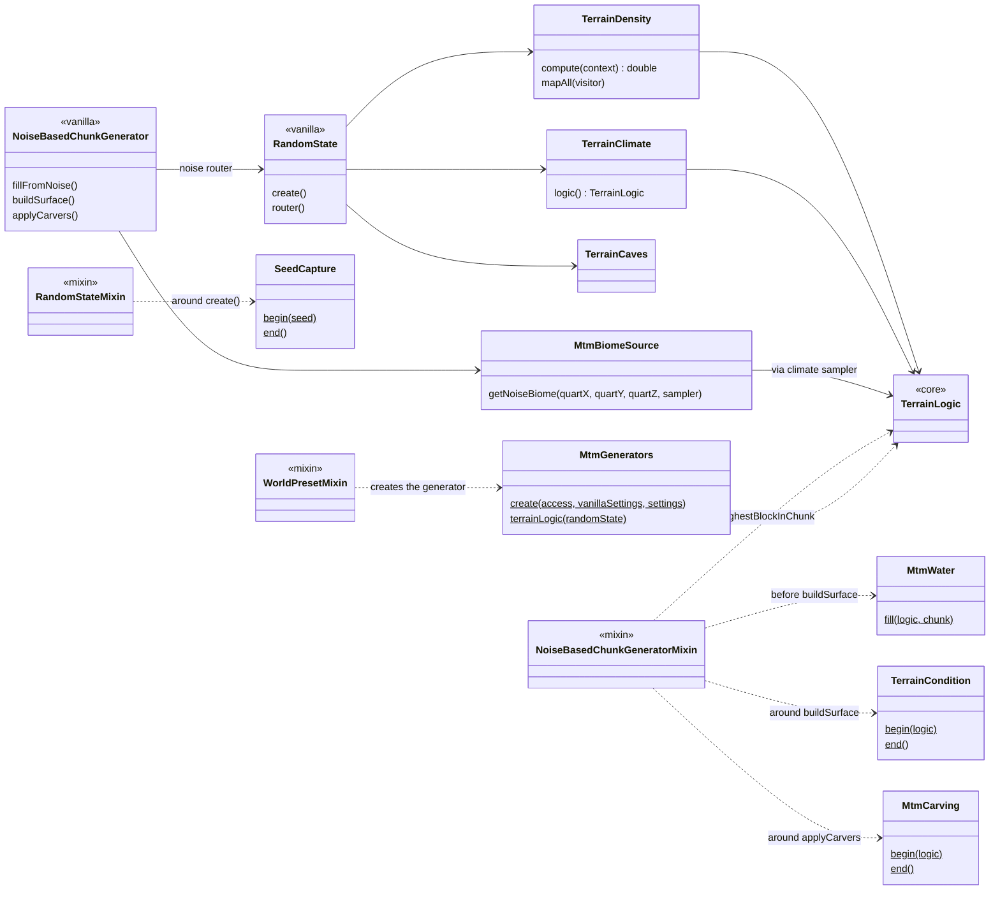

### Mixins

| Mixin | Hooks into | Why |
|---|---|---|
| `WorldPresetMixin` | `WorldPreset.createWorldDimensions` | Swaps the preset's placeholder for the real generator and build height from the config |
| `RandomStateMixin` | `RandomState.create` | Hands the seed to MTM density functions, which bind their `TerrainLogic` |
| `NoiseBasedChunkGeneratorMixin` | `fillFromNoise`, `buildSurface`, `applyCarvers` | Fills only up to the highest ground, places water, gives surface rules and carvers the logic, plants oases |
| `WorldCarverMixin` | `WorldCarver.carveBlock` | Every carved block passes here, so the surface can be protected |
| `HeightRangePlacementMixin` | `HeightRangePlacement.getPositions` | Stretches ore heights to the taller world, or leaves ores out |
| `ChunkGeneratorMixin` | `tryGenerateStructure` | Villages only on flat ground |
| `MinecraftServerMixin` | `setInitialSpawn` | Spawn chosen by the terrain logic, not vanilla's climate search |
| `ChunkSerializerMixin` | `ChunkSerializer.write` | Marks chunks with the world and algorithm version, to tell them from merged ones |
| `ServerLevelMixin` | `ServerLevel` init, `tickChunk` | Fits foreign chunks when the world loads; MTM snow line for weather |
| `SnowAndFreezeFeatureMixin` | `SnowAndFreezeFeature.place` | MTM snow line during generation |
| `BlenderMixin` | `Blender.of` | Turns off vanilla's blending toward old chunks |
| `RegistryDataLoaderMixin` | `loadRegistryContents` | Adds one MTM dimension type per possible build height |
| `WorldDimensionsMixin` | `isStableOverworld` | No "experimental" warning for the custom dimension type |

26.x versions have the same roles with different hooks, because vanilla rewrote its world generation in 26.1: filling, surface and carving happen together in `buildTerrain`, surface rules are material rules, and chunks are marked in `SerializableChunkData`. See CLAUDE.md for the details.

## Runtime flows

### Starting the game and creating a world

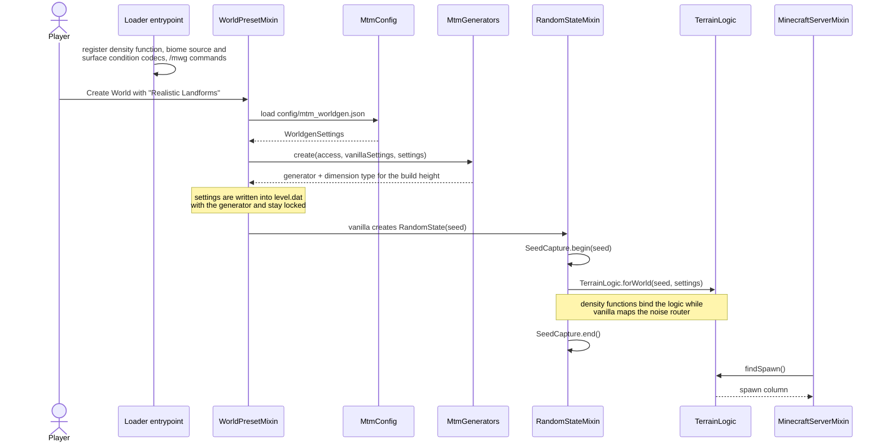

### Loading a world with merged maps

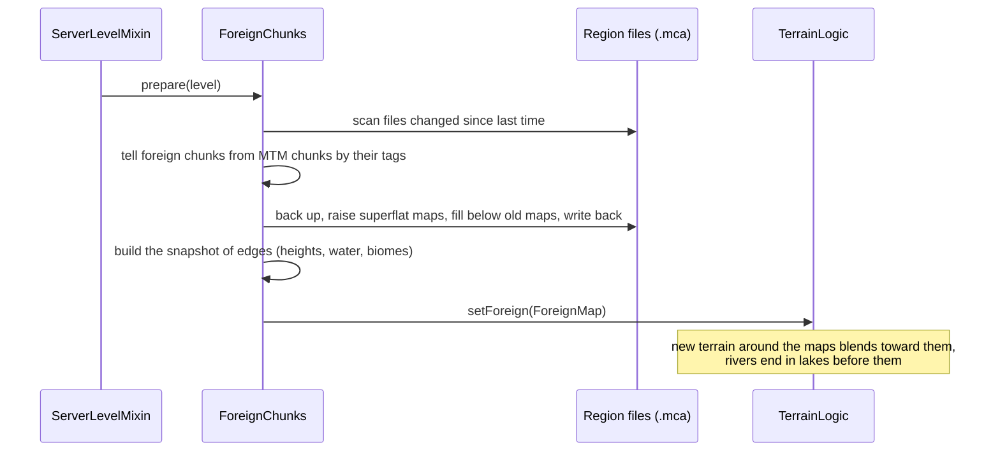

### Generating a chunk

Vanilla drives chunk generation through its usual statuses. MTM answers each one from the terrain logic:

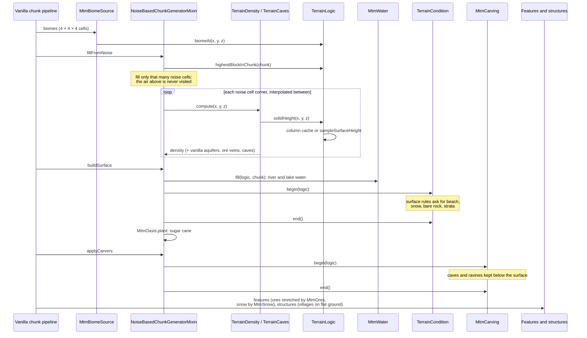

### Inside `sampleSurfaceHeight`

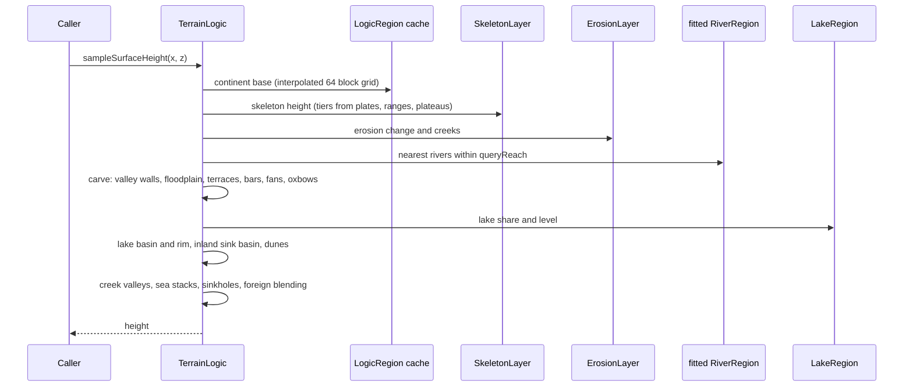

### Threads

Chunk generation runs on vanilla's worker threads, often many at once (and more with mods like C2ME). The logic is safe for that:

- Every result is a pure function of the seed, the coordinates and the settings, so the order and the number of threads never change it.
- `RegionCache` computes each region exactly once, whichever thread asks first; others wait for it or read it without locks once it is there.
- Expensive steps run their rows on `LogicThreads`. A caller already on that pool runs them itself, and callers block instead of helping, so no thread waits on itself.
- Memos (`ColumnCache`, the last river and creek, the last plate belts) are per thread.

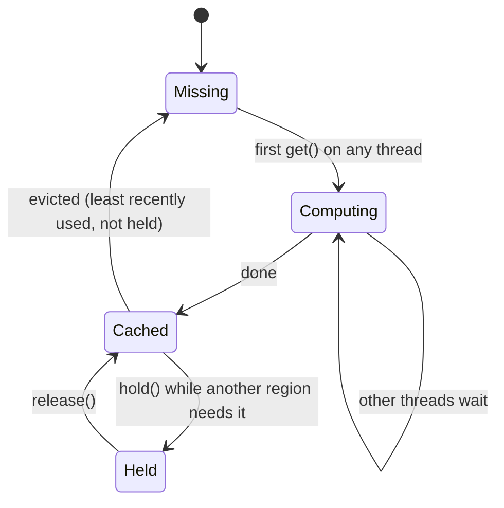

## Debugging and tools

| Tool | What it does |
|---|---|
| `/mwg locate mountain` | Nearest high mountain, with a coordinate to click |
| `/mwg debugmap` | PNG of terrain, rivers and region borders around the player (`HeightMapRenderer`) |
| `/mwg precompute` | Computes regions around the player ahead of time (`RegionPrecompute`) |
| `/mwg benchmark` | Chunk generation time against vanilla (`GenerationBenchmark`) |
| `java -jar <mod jar>` | Standalone map preview (`TerrainPreview`) |
| Amidst for MTM | Biome map, spawn and villages from a seed or save, by reflection into the mod jar |
| `gradlew :core:test` | Unit tests of the logic: determinism, order independence, region borders, rivers, lakes, slopes |
| GameTests | In-game tests on every loader and version, against one terrain hash |
