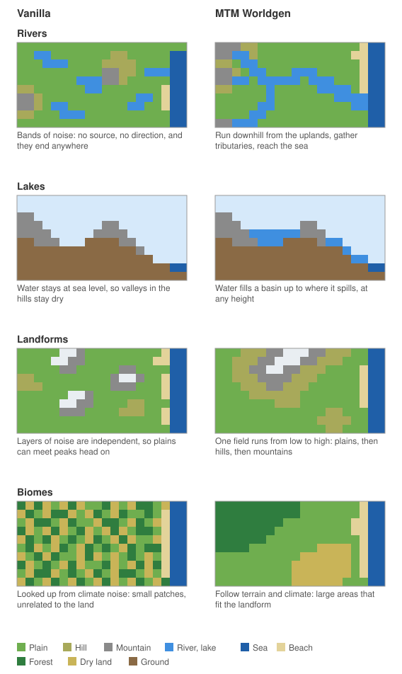

# How Realistic Landforms works

The mod keeps vanilla's chunk generator and replaces what it reads. Custom density functions tell it where the ground is, a custom biome source assigns biomes, and a few mixins add what density cannot express, such as water above sea level. Vanilla's surface rules, carvers, features and structures then run as usual.

## Why vanilla's terrain rules are not enough

The chunk generator itself is kept, but the terrain it normally computes cannot express this logic, even with data packs that retune it. Vanilla decides each block from noise at that point alone, through climate parameters and density functions. Nothing in that model can see beyond the position being computed:

- **Rivers need to know what lies upstream and downstream.** A river has to run downhill all the way, gather water from a whole basin and end in a sea or lake. Vanilla's rivers are bands of noise where a field crosses a value: they have no direction, no source, no size that grows, and they cannot link one place to another.
- **Water finds its own level.** A lake's surface depends on where its basin spills, which can be many kilometres away. Vanilla only knows sea level and local aquifers, so its water cannot sit at a height set by distant terrain, or descend along a course.
- **Landforms need order.** Plains should meet mountains through hills, and valleys should cut through where rivers actually run. Independent noise layers only produce that by chance, and shaping one layer to follow another turns into tuning fields against each other.
- **Biomes follow from terrain, not the reverse.** Vanilla looks biomes up from the same climate values that shape the land, so a biome cannot depend on real height, slope or distance to a snow line, and small climate changes produce mosaics.
- **Height costs time.** Vanilla evaluates 3D noise through the whole column. Doing that for a world over twice as tall would be far slower, while a height map only needs the surface.

The sketch below shows the difference, in simplified maps and a cross section. They are illustrations, not actual output.

So terrain is computed first, as large-scale logic that can look across thousands of blocks, and vanilla's generator is handed the result as its density. The rest of its pipeline, from surface rules to structures, keeps working unchanged. This logic stays deterministic because it never depends on generated chunks, only on the seed and coordinates.

## Terrain as a function of position

Everything is computed from the seed and block coordinates, without depending on what was generated before. That is what makes terrain independent of exploration order and thread timing, and identical across loaders. It also means neighboring areas always agree, so large-scale features need no stitching at borders. Logic regions of 4096 by 4096 blocks are only a cache of these results, not boundaries.

Height is built up in layers, each only depending on the ones before it:

1. **Continents.** Jittered Voronoi plates are grouped into landmasses, and a value that rises away from plate borders gives the coastlines, warped by noise. The land threshold is a per-seed quantile, so the ocean share holds for every seed.
2. **Climate.** A continuous temperature field is cut into zones in order, so tropical and cold zones can never touch. A separate field gives humidity.
3. **Plates and tiers.** One field divides land into plains, hills and mountains by quantile, and it is laid out by the plates. Each plate drifts its own way and is lowland or upland country as a whole. Along every border, the speed at which the two plates close in raises the field into a mountain belt or, where they part, lowers it into plains. Every pair of nearby plates counts, through how far a position lies from their shared border, so the field is continuous across borders and where three plates meet. Noise adds variety within each plate. The field is capped near coasts, which turns mountains into hills there. Plateaus follow the same plates: whole highland plates, and wide table lands beside the belts.
4. **Mountains.** Sites on a jittered grid link along a low-frequency direction field into winding ridge chains. A cross-section profile around each ridge gives the mountain body, with its shape and width derived from the slope limit, and a smooth maximum merges overlapping ridges.
5. **Drainage.** See below.
6. **Erosion.** Each region runs a stream power simulation on a 16 block grid: the land rises, water gathers downhill, cuts in where it runs strong, and slopes creep, until rise and cut balance in a branching drainage net. Rivers and lakes are held at their water level as base levels, so valleys grow down to the rivers that drain them. The result is scaled back to the designed heights, and the gullies that gather enough water become creeks.
7. **Surface and biomes.** Snow lines, bare rock, beaches and biomes follow from height, slope, climate and humidity.

## Rivers and lakes

Rivers are routed on a sparse grid with 256 block cells, in a window reaching 32768 blocks around each region:

- **Routing.** A priority flood runs inland from the sea, always continuing from the lowest water level reached so far. Each cell drains to the cell that reached it, so depressions fill up to their spill point and every cell finds a way out. Filled cells become lakes, and a finer flood of the ground around each lake sets its shore and the level it actually spills at, so lakes follow the terrain rather than the outline of their cells.
- **Size.** Catchment is counted along the routes, and tributaries are counted along each trunk to find major trunks. Water that never touched hills or mountains forms no river.
- **Courses.** Each cell gets a jittered node, and each flow edge a smooth curve with meanders seeded by that edge alone, so any region that builds an edge gets the same curve. Big rivers average their nodes over a longer stretch, because they are wider than the node spacing.
- **Shaping the land.** Valley walls bound the land from above and below, and low land nearby is flattened into a floodplain just above the water. Water levels are lowered onto the eroded ground where it lies lower, except in lakes and in the pools above waterfalls. Fans, terraces and oxbow lakes are found where rivers are built, from the slope above and below each node, and laid on the shaped land.
- **Water.** Water surfaces come from the routing grid and are written into chunks before surface rules run. Banks are built up or dug out around them where interpolated blocks land off the computed height. Lakes fill the real terrain, so their shores follow it.

## Performance

### Why a taller world costs vanilla more

Vanilla does not know where the ground is before it generates a chunk. Its terrain is a 3D density: every point is solid or air depending on noise at that point, so ground, overhangs and floating land can be anywhere in the column. The only way to find the surface is to evaluate the density everywhere.

So vanilla fills every chunk through the whole build height, from the bottom of the world to the top:

- **Density at noise points.** The density is evaluated on a grid of points 4 blocks apart horizontally and 8 apart vertically, 5 × 5 per chunk at each level. Each evaluation runs the whole density tree: continents, erosion, ridges, jaggedness and the cave noises.
- **Every block.** Between those points the density is interpolated for every block, and the aquifer and ore vein rules run on every block, including the air far above the ground.

Both grow in proportion to the build height, while the ground mostly stays in the lower part of it:

| Build height | Noise point levels | Noise points per chunk | Blocks per chunk |
|---|---|---|---|
| -64 to 320 (vanilla) | 49 | 1,225 | 98,304 |
| -64 to 1648 (this mod's default) | 215 | 5,375 | 438,272 |
| -64 to 2032 (Minecraft's maximum) | 263 | 6,575 | 536,576 |

Raising the build limit with a data pack keeps this approach, so a world as tall as Minecraft allows does more than five times the work of vanilla for every chunk, even where the ground is at sea level. Richer density functions, with more noise layers for taller mountains, add to the cost of every one of those points.

### How this mod avoids it

The terrain here is a height map: the logic gives the surface height of every column directly, and the density only compares a block's height with it. Before a chunk is filled, the logic knows the highest solid block in it, overhangs included, so filling stops 32 blocks above that, leaving room for structure foundations. The air above is never visited: no density, interpolation, aquifer or ore vein work.

The cost of a chunk therefore follows the height of its ground, not the build limit. A chunk on plains near sea level fills about 170 blocks of its column whether the world ends at 320, 1648 or 2032; only mountain chunks fill higher, and only as high as their peaks. This is why the mod can run a world several times as tall as vanilla in less time per chunk.

### Other measures

Terrain is a height map rather than vanilla's 3D noise, so density is simple to compute. Chunks are only filled up to their highest surface, which skips interpolation, aquifers and ore veins for the air above it, and this is where most of the time is saved. Logic that many columns share is cached by region, and the erosion of each region, the most expensive part, is also kept in `<world>/mtm_worldgen/erosion/` so it is not computed again after a restart. Deleting that folder is safe: the same results are computed again. Expensive steps run on a small fork-join pool, which is safe because they are pure functions of the seed and coordinates, so the number of threads cannot change the result.
